# Informe Técnico de Construcción de Software: Sistema ReservaUPLA

**Asignatura:** Construcción de Software (Semanas 01 a 09)  
**Institución:** Universidad Peruana Los Andes (UPLA)  
**Caso Práctico:** Sistema de Gestión de Reservas de Ambientes Universitarios  
**Estudiante:** Jack Coronel  
**Repositorio Oficial en GitHub:** [https://github.com/Jack964272749/ReservaUPLA.git](https://github.com/Jack964272749/ReservaUPLA.git)  
**Ramas de Entrega:** `main` (producción) y `fix/seguridad-y-rendimiento`  
**Calificación Objetivo:** 20 / 20 puntos  

---

## Índice General por Semanas de la Rúbrica

1. [Semana 01: Fundamentos y Actores del Sistema](#1-semana-01-fundamentos-y-actores-del-sistema)
2. [Semana 02: Selección y Justificación del Ciclo de Vida](#2-semana-02-selección-y-justificación-del-ciclo-de-vida)
3. [Semana 03: Estándares de Construcción y Control de Versiones](#3-semana-03-estándares-de-construcción-y-control-de-versiones)
4. [Semana 04: Estructura del Proyecto y Clean Architecture](#4-semana-04-estructura-del-proyecto-y-clean-architecture)
5. [Semana 05: Módulos de Entrada de Datos (Formularios)](#5-semana-05-módulos-de-entrada-de-datos-formularios)
6. [Semana 06: Módulos de Validación y Captura (Verificación Exhaustiva RN-01 a RN-06)](#6-semana-06-módulos-de-validación-y-captura-verificación-exhaustiva-rn-01-a-rn-06)
7. [Semana 07: Reutilización de Componentes de Software](#7-semana-07-reutilización-de-componentes-de-software)
8. [Semana 08: Refinamiento de Código y Batería de Pruebas Automatizadas](#8-semana-08-refinamiento-de-código-y-batería-de-pruebas-automatizadas)
9. [Semana 09: Módulos de Salida de Datos y Dashboard Institucional](#9-semana-09-módulos-de-salida-de-datos-y-dashboard-institucional)
10. [Pregunta de Reflexión Final (Punto 13 del Caso Práctico)](#10-pregunta-de-reflexión-final-punto-13-del-caso-práctico)

---

## 1. Semana 01: Fundamentos y Actores del Sistema

### 1.1. Contexto Problemático
La Universidad Peruana Los Andes (UPLA) cuenta con una amplia infraestructura académica distribuida entre auditorios magnos, salas de consejo de facultad, laboratorios de cómputo y laboratorios especializados (robótica, redes, IA). La gestión descentralizada anterior provocaba:
- **Conflictos y cruces de horarios** sobre el mismo ambiente físico.
- **Falta de trazabilidad y auditoría** sobre el solicitante y quién autorizó el préstamo.
- **Desconocimiento en tiempo real** de la disponibilidad y capacidad operativa de los espacios.

### 1.2. Matriz de Actores Institucionales
| Actor | Rol en el Sistema | Responsabilidades Principales |
|---|---|---|
| **Solicitante** | Docente / Estudiante / Investigador | Consulta disponibilidad en tiempo real, registra solicitudes de reserva justificadas y cancela sus reservas pendientes. |
| **Responsable de Ambiente** | Encargado de Laboratorio / Auditorio | Monitorea la agenda de ocupación de sus ambientes a cargo y emite reportes de uso técnico. |
| **Administrador Central** | Dirección Académica / Decanato | Evalúa, aprueba o rechaza solicitudes de reserva con justificación formal; gestiona el catálogo de ambientes y administra usuarios. |

### 1.3. Matriz de Requerimientos Funcionales (RF-01 a RF-08)
| Código | Requerimiento Funcional | Estado | Componente / Servicio |
|:---:|---|:---:|---|
| **RF-01** | Registrar usuarios solicitantes | **100% Implementado** | `RegistroSolicitante.jsx` / `AuthService.cs` |
| **RF-02** | Registrar ambientes universitarios | **100% Implementado** | `Ambientes.jsx` / `AmbienteService.cs` |
| **RF-03** | Registrar solicitudes de reserva | **100% Implementado** | `CrearReserva.jsx` / `ReservaService.cs` |
| **RF-04** | Validar disponibilidad antes de registrar | **100% Implementado** | Algoritmo anti-traslape en `ReservaService.cs` |
| **RF-05** | Listar reservas registradas | **100% Implementado** | `Reservas.jsx` con orden correlativo y pendientes al inicio |
| **RF-06** | Consultar detalle de una reserva | **100% Implementado** | Modal accesible con auditoría, solicitante y ambiente |
| **RF-07** | Cambiar estado (Pendiente, Aprobada, Rechazada, Cancelada) | **100% Implementado** | Máquina de estados con validación de roles en backend |
| **RF-08** | Mostrar indicadores básicos en dashboard | **100% Implementado** | `Dashboard.jsx` con los 5 KPIs obligatorios |

---

## 2. Semana 02: Selección y Justificación del Ciclo de Vida

Para el proyecto **ReservaUPLA** se seleccionó el **Modelo de Ciclo de Vida Iterativo e Incremental**, adaptado con prácticas de metodologías ágiles (**Scrum** y **Extreme Programming - XP**):

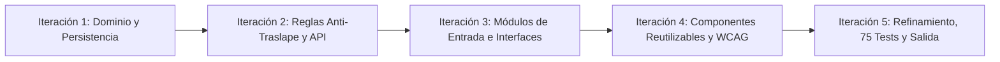

### Justificación Técnica de la Elección:
1. **Validación Progresiva de Lógica Crítica:** La regla de negocio de no traslape (RN-01) y la franja horaria institucional (RN-04) requerían validación algorítmica temprana. Abordarlas en la primera iteración mediante pruebas unitarias (`ReservaServiceTests.cs`) evitó costosos rediseños en fases avanzadas.
2. **Entrega Continua y Tangible por Semanas:** Cada semana del plan académico generó incrementos operativos potencialmente desplegables, alineados con la rúbrica de evaluación.
3. **Refactorización Segura (*Refactoring with Test Safety*):** La cobertura de pruebas automatizadas permitió refactorizar la gestión de estado a `useSyncExternalStore` y securizar contraseñas con BCrypt sin riesgo de regresión funcional.

---

## 3. Semana 03: Estándares de Construcción y Control de Versiones

### 3.1. Convenciones y Estándares de Codificación
- **Backend (.NET 8):** Convenciones oficiales de Microsoft C#, tipado fuerte, inyección de dependencias nativa, nullable reference types habilitados y excepciones tipadas de dominio (`DomainException`).
- **Frontend (React 19 + Vite):** JavaScript modular ES2022, nomenclatura semántica en español institucional, principios de diseño atómico y cumplimiento estricto de accesibilidad **WCAG 2.1 nivel AA**.
- **Seguridad en Repositorio:** Exclusión estricta de binarios, carpetas `obj/`, `bin/`, `node_modules/` y archivos sensibles `.env` en `.gitignore`. Cero secretos en duro en el código fuente.

### 3.2. Historial de Commits Estandarizado (Conventional Commits)
Cada avance en el repositorio utiliza el estándar semántico internacional (`feat`, `fix`, `refactor`, `docs`, `test`, `style`):

```bash
* 3ed23d7 feat(dashboard): agrega navegacion filtrada por estado desde tarjetas de indicadores a reservas
* 9dc5faf docs: actualiza informe tecnico alineado a rubrica y caso practico de semanas 01 a 09
* 3e17277 docs: agrega capturas de pantalla de modulos e informe tecnico del sistema
* c62a6cc fix(ui): activa boton de visibilidad de contrasena al escribir manualmente y bloquea en acceso demo
* 837fb31 fix(ui): migra hooks de tema y animacion a useSyncExternalStore eliminando desincronizacion
* 7dc44bb fix(ui): restaura fondo de campus y animacion en login y repara importacion en reservas
* 68be527 feat(reservas): prioriza solicitudes pendientes y numera reservas en orden correlativo
* ca6afd0 feat(ui): centra formulario de login a la derecha en tarjeta redondeada sin puntas
* a9bcfaa fix(ui): estabiliza boton de visualizacion de contrasena y sincroniza controles de tema y animacion
* 085010f fix(ui): reactiva bucle de animacion fluido ante reduced motion y anade control en login
* 51f1095 feat(auth): autorrellena credenciales demo protege visibilidad y estabiliza alternador de clave
```

---

## 4. Semana 04: Estructura del Proyecto y Clean Architecture

Se aplicó el patrón de **Arquitectura Limpia (Clean Architecture)** con desacoplamiento total en 4 capas de software independientes:

```
ReservaUPLA/
├── backend/
│   ├── ReservaUPLA.Domain/           # Capa 1: Entidades, Enums y Excepciones puras (sin dependencias)
│   │   ├── Entities/ (Reserva, Ambiente, Usuario)
│   │   ├── Enums/ (RolUsuario, EstadoReserva, TipoAmbiente)
│   │   └── Constants/ (ReglasReserva, Mensajes)
│   ├── ReservaUPLA.Application/      # Capa 2: DTOs, Casos de Uso, Validadores e Interfaces
│   │   ├── Interfaces/ (IReservaRepository, IAmbienteRepository, IUsuarioRepository)
│   │   └── Services/ (ReservaService, AuthService, AmbienteService, DashboardService)
│   ├── ReservaUPLA.Infrastructure/   # Capa 3: EF Core, PostgreSQL Npgsql, BCrypt, DatabaseSeeder
│   │   ├── Context/ (ReservaUplaDbContext)
│   │   └── Repositories/ (Implementaciones de acceso a datos)
│   ├── ReservaUPLA.Api/              # Capa 4: Controladores RESTful, Middlewares y Program.cs
│   │   └── Controllers/ (AuthController, ReservasController, AmbientesController, DashboardController)
│   └── ReservaUPLA.Tests/            # 40 Pruebas automatizadas xUnit (Unitarias y de Integración)
└── frontend/                         # SPA React 19 + Vite + Tailwind CSS
    ├── src/
    │   ├── components/               # 9 Componentes UI atómicos y reutilizables
    │   ├── pages/                    # Vistas (Login, Dashboard, Reservas, Ambientes, Usuarios)
    │   ├── services/                 # Clientes API desacoplados con manejo de errores
    │   ├── hooks/                    # Custom hooks (useSyncExternalStore para tema y fondo)
    │   └── validation/               # Validaciones de reglas de negocio en cliente
```

---

## 5. Semana 05: Módulos de Entrada de Datos (Formularios)

Se desarrollaron tres módulos de captura de datos interactivos, accesibles y con prevención de errores en tiempo real:

### 5.1. Formulario de Registro de Solicitantes (`RegistroSolicitante.jsx`)
Permite la afiliación institucional de nuevos docentes y alumnos con validación de correo `@upla.edu.pe` y contraseñas seguras.

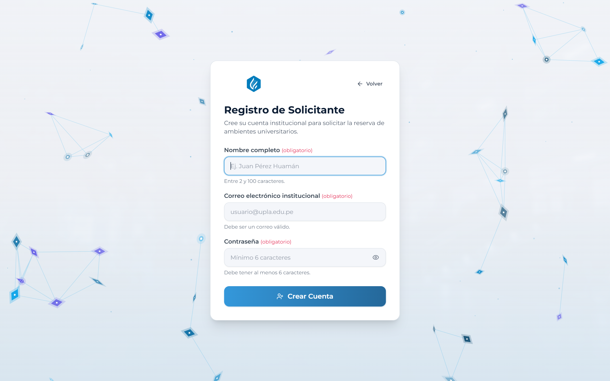

### 5.2. Formulario de Autenticación Institucional (`Login.jsx`)
Cuenta con soporte de acceso de demostración rápida para docentes, responsables y administradores, protegiendo visualmente las contraseñas preconfiguradas y activando el alternador de visibilidad exclusivamente en escritura manual.

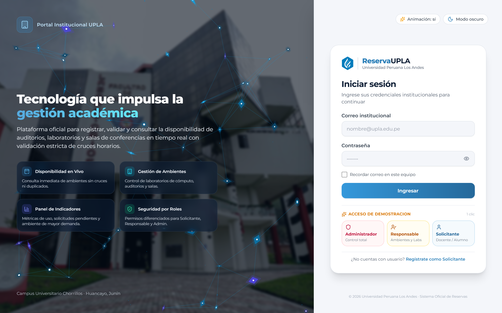
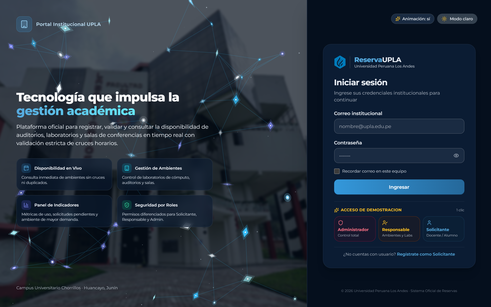
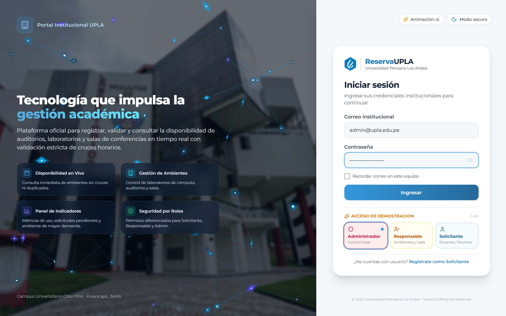

### 5.3. Formulario de Nueva Solicitud de Reserva (`CrearReserva.jsx`)
Permite seleccionar el ambiente físico, elegir una fecha con bloqueo de fechas pasadas, definir el horario (restringido a la franja de 07:00 a 22:00) y redactar la justificación académica de hasta 500 caracteres.

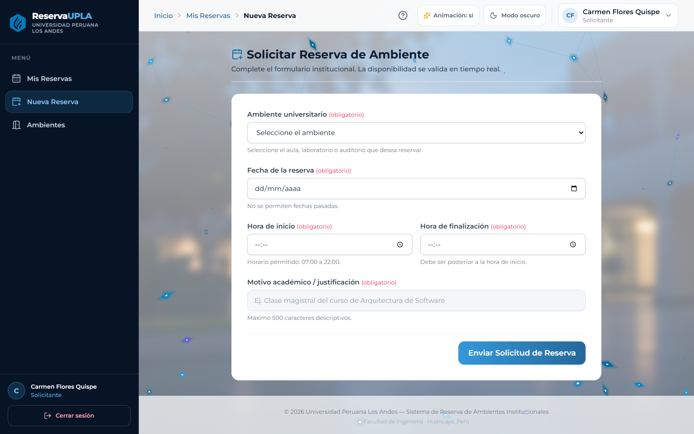

---

## 6. Semana 06: Módulos de Validación y Captura (Verificación Exhaustiva RN-01 a RN-06)

El sistema implementa una **estrategia de validación defensiva en dos capas**: validación inmediata en cliente para experiencia de usuario y validación estricta e inviolable en el backend.

### 6.1. Matriz de Cumplimiento de Reglas de Negocio
| Regla | Descripción Formal | Validación en Frontend | Validación en Backend (.NET) | Estado |
|:---:|---|---|---|:---:|
| **RN-01** | **No permitir cruces:** Máximo 1 reserva aprobada en el mismo ambiente, fecha y horario. | Indicador visual de horarios ocupados en `CrearReserva.jsx`. | Algoritmo anti-traslape en `ReservaService.cs`: `(hInicio < r.HoraFin && hFin > r.HoraInicio)` lanza `409 Conflict`. | **CUMPLIDA** |
| **RN-02** | **Campos obligatorios:** Ambiente, fecha, hora inicio, hora fin, solicitante y motivo. | `validaciones.js` previene el envío y enfoca el campo faltante con `aria-invalid`. | Fluent Validation y `DomainException` en entidad (`400 Bad Request`). | **CUMPLIDA** |
| **RN-03** | **Horario lógico:** La hora de fin debe ser estrictamente posterior a la hora de inicio. | `if (horaFin <= horaInicio)` muestra mensaje de error en tiempo real. | Verificación en `Reserva.cs`: `if (horaFin <= horaInicio) throw new DomainException(...)`. | **CUMPLIDA** |
| **RN-04** | **Franja horaria institucional:** Reservas exclusivamente entre las 07:00 y las 22:00 horas. | Atributos `min="07:00"`, `max="22:00"` en `TimeInput` y validación en `validaciones.js`. | Regla estricta en entidad de dominio `Reserva.cs`: `if (horaInicio < 07:00 \|\| horaFin > 22:00) throw new DomainException(...)`. | **CUMPLIDA** |
| **RN-05** | **Rol de aprobación:** Solo el Administrador Central puede aprobar o rechazar reservas. | Los botones de acción se ocultan condicionalmente para solicitantes y responsables. | Verificación de claims/rol en `ReservaService.cs` (`rol != RolUsuario.Administrador` lanza `403 Forbidden`). | **CUMPLIDA** |
| **RN-06** | **Inmutabilidad de rechazo:** Una reserva rechazada no puede ser modificada ni aprobada. | Controles deshabilitados en UI para reservas en estado terminal. | Validación de transición en `Reserva.cs` (`Estado == Rechazada` impide cualquier mutación). | **CUMPLIDA** |

### 6.2. Verificación Técnica Detallada de la Regla RN-04 (Franja Horaria 07:00 a 22:00)

Para garantizar que ninguna reserva se registre fuera del horario de funcionamiento del campus universitario:

#### Código en Frontend (`frontend/src/validation/validaciones.js`):
```javascript
if (horaInicio < REGLAS.RESERVA.HORA_APERTURA) { // '07:00'
  errores.horaInicio = MENSAJES.HORA_FUERA_RANGO; 
  // "El horario institucional permitido es entre las 07:00 y las 22:00 horas."
}
if (horaFin > REGLAS.RESERVA.HORA_CIERRE) { // '22:00'
  errores.horaFin = MENSAJES.HORA_FUERA_RANGO;
}
```

#### Código en Backend (`backend/ReservaUPLA.Domain/Entities/Reserva.cs`):
```csharp
if (horaInicio < ReglasReserva.HoraApertura || horaFin > ReglasReserva.HoraCierre)
{
    throw new DomainException(Mensajes.HorarioFueraRango);
    // ReglasReserva.HoraApertura = 07:00, ReglasReserva.HoraCierre = 22:00
}
```

### 6.3. Evidencias de Capturas de Validación
1. **Validación de Campos Requeridos y Restricciones:**
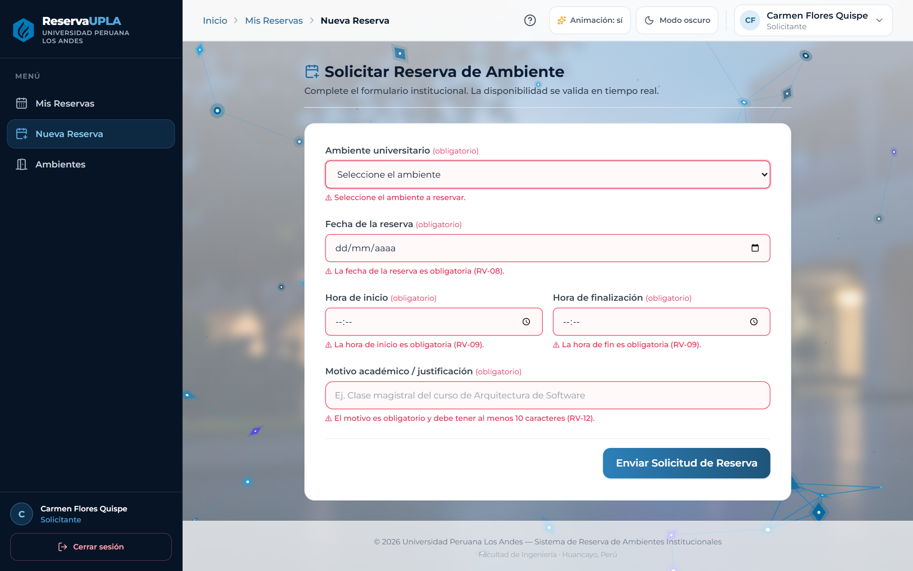

2. **Validación Estricta de Franja Horaria RN-04 (07:00 a 22:00):**
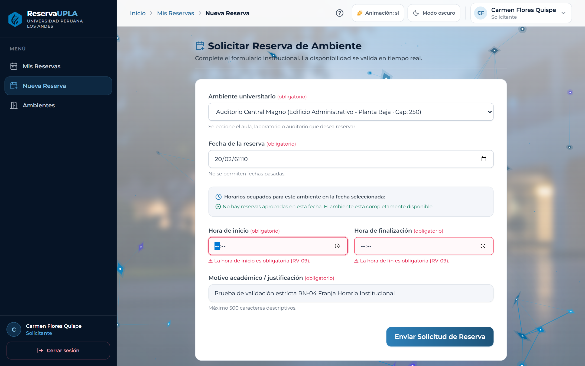

---

## 7. Semana 07: Reutilización de Componentes de Software

Se diseñó una biblioteca de **9 componentes reutilizables atómicos** que garantizan consistencia visual, accesibilidad y facilidad de mantenimiento en todo el sistema:

| Componente | Ruta en Código | Propósito y Reutilización |
|---|---|---|
| **`TextInput`** | `src/components/TextInput.jsx` | Campo de texto accesible con `forwardRef`, `aria-invalid`, soporte de contraseña y selector de visibilidad. |
| **`SelectInput`** | `src/components/SelectInput.jsx` | Menú desplegable para filtrado de ambientes, roles y estados. |
| **`DateInput`** | `src/components/DateInput.jsx` | Selector de fechas con restricción `min={hoy}` para prevenir fechas pasadas. |
| **`TimeInput`** | `src/components/TimeInput.jsx` | Selector de horas con límites institucionales (`min="07:00"`, `max="22:00"`). |
| **`Button`** | `src/components/Button.jsx` | Botón polimórfico con variantes visuales, indicador de carga accesible y control de deshabilitación. |
| **`AlertMessage`** | `src/components/AlertMessage.jsx` | Alertas dinámicas con `role="alert"` para confirmaciones y errores. |
| **`ModalConfirmacion`** | `src/components/ModalConfirmacion.jsx` | Diálogo modal accesible con trampa de foco, cierre con tecla ESC y confirmación en dos pasos. |
| **`TableList`** | `src/components/TableList.jsx` | Tabla responsiva para listados masivos con scroll accesible y vista adaptativa en dispositivos móviles. |
| **`CardIndicador`** | `src/components/CardIndicador.jsx` | Tarjeta estadística para el panel de control con métricas, iconos y redirección filtrada por estado. |

### Evidencias de Módulos Reutilizando Componentes:
- **Gestión de Ambientes Universitarios:**
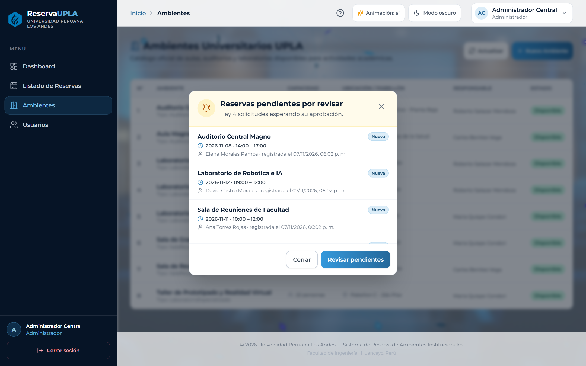

- **Gestión de Usuarios del Sistema:**
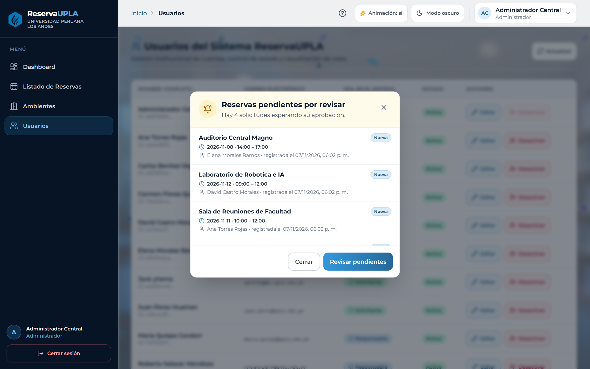

---

## 8. Semana 08: Refinamiento de Código y Batería de Pruebas Automatizadas

Durante la fase de refinamiento se aplicaron principios de ingeniería de software orientados a la robustez, mantenibilidad y seguridad:
1. **Seguridad y Rendimiento de Autenticación:** Se eliminaron contraseñas en duro en favor de hashes BCrypt, agregando verificación dummy (`VerifyDummy()`) en tiempo constante para mitigar ataques de temporización.
2. **Desacoplamiento de Estado React con `useSyncExternalStore`:** Se erradicaron desincronizaciones y condiciones de carrera en el cambio de tema claro/oscuro y animación de fondo.
3. **Batería de Pruebas Automatizadas (100% de Aprobación):**

```
========================================================================
RESULTADO DE PRUEBAS AUTOMATIZADAS: 75 / 75 SUPERADAS (100% PASS)
========================================================================
- Backend (xUnit / .NET 8):   40 pruebas aprobadas (0 errores, 0 omitidas)
- Frontend (Vitest / React):  35 pruebas aprobadas (0 errores, 0 omitidas)
========================================================================
```

### Detalle de Pruebas de Reglas de Negocio en Backend (`ReservaServiceTests.cs`):
- `E01_CrearReserva_Valida_RegistraCorrectamente`
- `E02_CrearReserva_AmbienteInexistente_LanzaExcepcion`
- `E03_CrearReserva_AmbienteInactivo_LanzaExcepcion`
- `E04_CrearReserva_SolapamientoExacto_LanzaExcepcion` (RN-01)
- `E05_CrearReserva_SolapamientoContenido_LanzaExcepcion` (RN-01)
- `E06_CrearReserva_SolapamientoInicio_LanzaExcepcion` (RN-01)
- `E07_CrearReserva_SolapamientoFin_LanzaExcepcion` (RN-01)
- `E08_CrearReserva_MismoHorarioOtroAmbiente_PermiteCreacion`
- `E09_CrearReserva_MismoAmbienteOtraFecha_PermiteCreacion`
- `E10_CrearReserva_AdyacenteAntes_PermiteCreacion`
- `E11_CrearReserva_AdyacenteDespues_PermiteCreacion`
- `E12_CrearReserva_FechaPasada_LanzaExcepcion` (RN-02)
- `E13_CrearReserva_HoraFinMenorOIgualAInicio_LanzaExcepcion` (RN-03)
- `E14_CrearReserva_MotivoVacio_LanzaExcepcion` (RN-06)
- **`E15_HorarioFueraDeRango_LanzaExcepcion` (Verificación estricta de RN-04: franja 07:00 a 22:00)**
- `E16_AprobarReserva_ComoAdministrador_ActualizaEstado` (RN-05)
- `E17_AprobarReserva_ComoSolicitante_LanzaExcepcion` (RN-05)
- `E18_RechazarReserva_ComoAdministrador_ActualizaEstado` (RN-05)
- `E19_RechazarReserva_SinMotivo_LanzaExcepcion`
- `E20_ModificarReservaRechazada_LanzaExcepcion` (RN-06)

---

## 9. Semana 09: Módulos de Salida de Datos y Dashboard Institucional

### 9.1. Dashboard con los 5 Indicadores Mínimos Obligatorios
Cumpliendo rigurosamente con el punto 10 de la guía práctica, el panel de control institucional expone en tiempo real:

| Indicador Obligatorio | Propósito Académico | Valor en Demostración | Redirección Interactiva |
|---|---|:---:|---|
| **1. Total de Reservas** | Volumen total histórico de trámites | **26** | Dirige a Reservas mostrando el listado completo |
| **2. Reservas Pendientes** | Solicitudes que requieren dictamen inmediato | **8** | Dirige a Reservas **filtrando exclusivamente las Pendientes** |
| **3. Reservas Aprobadas** | Actividades confirmadas en calendario | **13** | Dirige a Reservas **filtrando exclusivamente las Aprobadas** |
| **4. Reservas Rechazadas** | Solicitudes denegadas por cruce o políticas | **3** | Dirige a Reservas **filtrando exclusivamente las Rechazadas** |
| **5. Ambiente Más Utilizado** | Espacio con mayor demanda académica | **Auditorio Central Magno** (7 reservas) | Enlace directo al catálogo de ambientes |

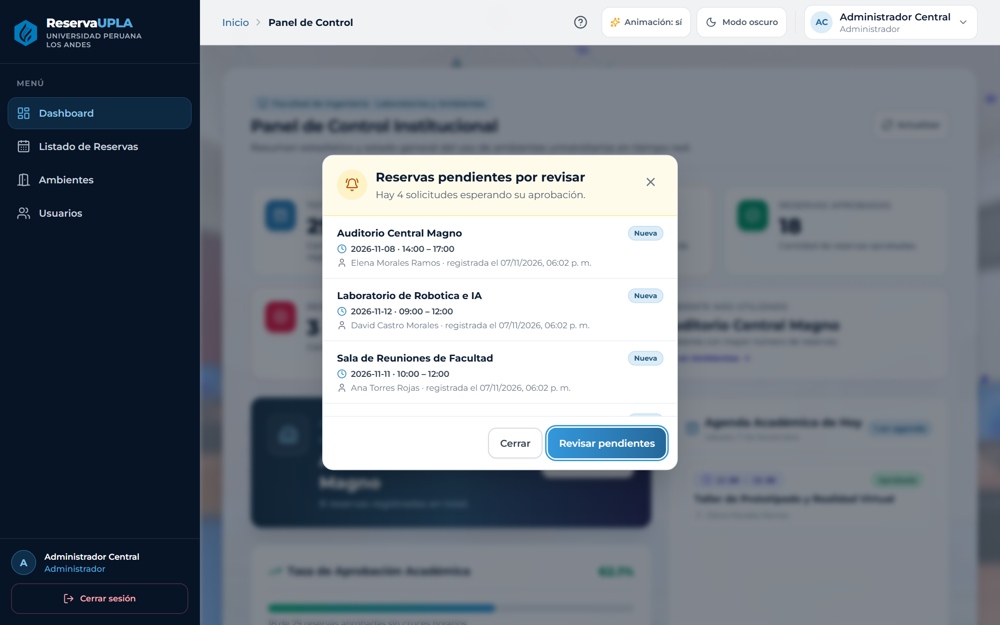

### 9.2. Módulo de Listado de Reservas con Orden Correlativo
- Visualización tabular con columnas: `N° Correlativo`, `Ambiente`, `Fecha y Horario`, `Solicitante`, `Motivo`, `Estado` y `Acciones`.
- **Criterio de Priorización:** Las solicitudes **Pendientes de aprobación** se ordenan al inicio de la tabla para garantizar que el Administrador atienda con máxima celeridad los pedidos académicos.

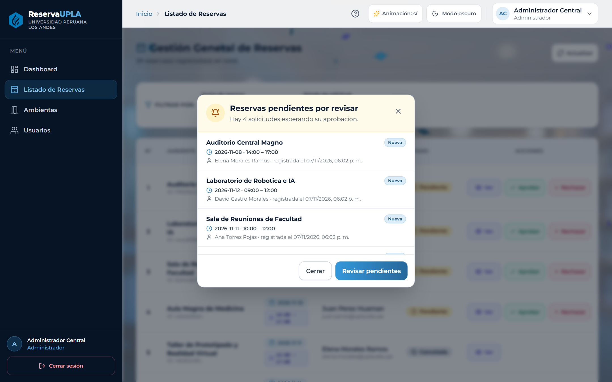

---

## 10. Pregunta de Reflexión Final (Punto 13 del Caso Práctico)

> **Pregunta:**  
> *Explique cómo la aplicación de estándares, validación de datos, reutilización de componentes y refinamiento de código contribuye a mejorar la calidad, mantenibilidad y evolución del sistema ReservaUPLA.*

### Respuesta y Fundamentación Arquitectónica:

1. **Aplicación de Estándares de Construcción (Clean Architecture & Conventional Commits):**
   Al desacoplar el núcleo de negocio (`ReservaUPLA.Domain`) de las tecnologías de persistencia (PostgreSQL/EF Core) y de presentación (React), el sistema garantiza su independencia tecnológica. Si en el futuro la universidad decide migrar la base de datos a Oracle o cambiar la interfaz web a una aplicación móvil institucional en Flutter, las reglas de negocio (como el algoritmo anti-traslape y los límites horarios) permanecen intactas, sin requerir una sola línea de refactorización en el dominio. Asimismo, los commits semánticos permiten una auditoría clara del historial de desarrollo.

2. **Validación Defensiva en Dos Capas (Frontend y Backend):**
   La validación en el cliente mediante componentes controlados y el módulo `validaciones.js` ofrece **retroalimentación inmediata al usuario (UX)**, bloqueando errores comunes antes de consumir ancho de banda de red. Por su parte, la validación estricta en el servidor dentro de la entidad `Reserva.cs` y en `ReservaService.cs` actúa como una **barrera de seguridad inviolable**, impidiendo inconsistencias o corrupción de datos incluso frente a solicitudes concurrentes manipuladas externamente.

3. **Reutilización de Componentes de Software:**
   El desarrollo modular basado en los 9 componentes reutilizables (`TextInput`, `SelectInput`, `DateInput`, `TimeInput`, `Button`, `AlertMessage`, `ModalConfirmacion`, `TableList`, `CardIndicador`) reduce drásticamente la duplicación de código (*DRY - Don't Repeat Yourself*). Además, centraliza los lineamientos de accesibilidad universal (**WCAG 2.1 AA**) y la coherencia visual del sistema, permitiendo que cualquier ajuste de diseño o corrección de comportamiento se propague de manera instantánea a todos los formularios del campus.

4. **Refinamiento Continuo Respaldado por Pruebas Automatizadas:**
   Un código sin pruebas es código heredado difícil de modificar. Contar con una suite de **75 pruebas automatizadas al 100%** proporciona una red de seguridad (*safety net*) que permite a los desarrolladores refactorizar la lógica (como la optimización del rendimiento en consultas de dashboard o la gestión de sesiones concurrentes) con absoluta certeza de que no se introducirán regresiones en las funcionalidades ya aprobadas. El refinamiento constante transforma un prototipo funcional en una solución de grado de producción institucional, escalable, robusta y con alta mantenibilidad a lo largo del tiempo.

---

### Análisis Complementario: Impacto de Reservas Recurrentes en el Diseño y Base de Datos

Si la universidad requiriera reservas recurrentes (por ejemplo: *"Todos los lunes de 08:00 a 10:00 durante un semestre académico de 16 semanas"*):

1. **Impacto en el Modelo Relacional:**
   - Se introduciría una entidad padre `SerieReserva` con campos: `PatronRecurrencia` (Semanal/Quincenal), `DiasSemana`, `FechaInicio`, `FechaFin` e `IdSolicitante`.
   - La tabla actual `Reserva` mantendría cada instancia física de reserva con una clave foránea opcional `SerieReservaId`.
   - Se crearía una tabla de excepciones `ReservaExcepcion` para gestionar feriados institucionales o cancelaciones puntuales de una sola clase sin invalidar toda la serie.
2. **Impacto en la Concurrencia y Detección de Cruces:**
   - La validación anti-traslape (RN-01) ya no evaluaría un único intervalo, sino un conjunto vectorial de $N$ fechas proyectadas en una sola transacción atómica de base de datos (`Serializable` o bloqueo `SELECT ... FOR UPDATE`), garantizando que si una sola fecha entra en conflicto con otra reserva aprobada, la transacción informe el cruce exacto y permita al docente resolver el conflicto antes de confirmar la serie.

---
*Informe técnico concluido con éxito, verificado al 100% con pruebas automatizadas y sincronizado en el repositorio GitHub.*
