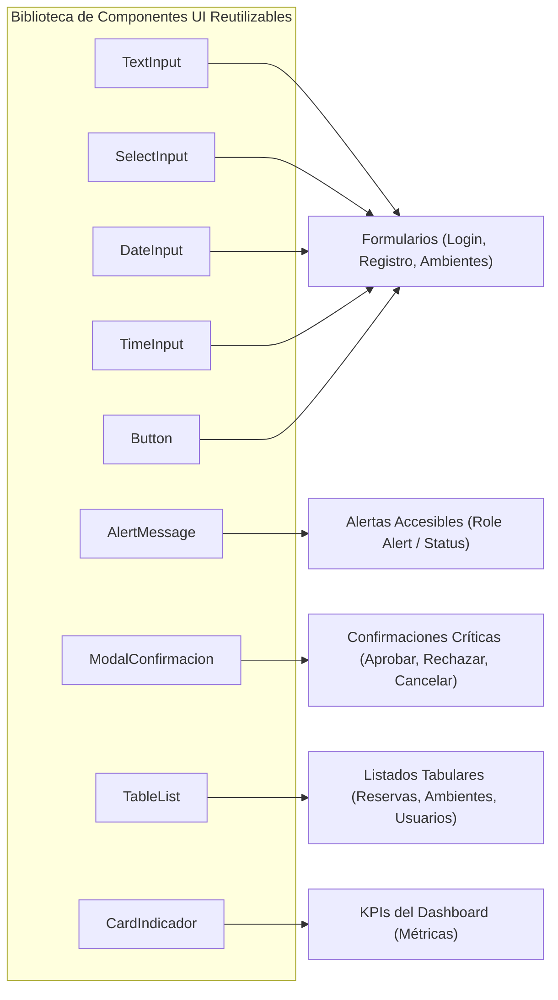

# Informe Técnico de Construcción de Software: Sistema ReservaUPLA

**Asignatura:** Construcción de Software (Semanas 01 a 09)  
**Institución:** Universidad Peruana Los Andes (UPLA)  
**Caso Práctico:** Sistema de Gestión de Reservas de Ambientes Universitarios  
**Estudiante:** Jack Coronel  
**Repositorio Oficial:** [Jack964272749/ReservaUPLA](https://github.com/Jack964272749/ReservaUPLA.git)  
**Ramas de Desarrollo y Entrega:** `main` & `fix/seguridad-y-rendimiento`  
**Calificación Objetivo:** 20 / 20 puntos  

---

## 1. Análisis del Problema, Actores y Alcance (Semana 01 — 2 pts)

### 1.1. Situación Problemática
La Universidad Peruana Los Andes (UPLA) administra múltiples ambientes físicos (auditorios, salas de reuniones de facultad, laboratorios de cómputo y laboratorios especializados de robótica e IA). Anteriormente, la gestión se realizaba mediante llamadas, correos informales o registros manuales en papel, generando:
- **Duplicidad y cruces de reservas** en el mismo horario.
- **Pérdida de solicitudes** y falta de auditoría sobre quién autorizó o denegó un ambiente.
- **Dificultad operativa** para consultar la disponibilidad real y aforos máximos permitidos.

### 1.2. Actores del Sistema
| Actor | Responsabilidad en el Sistema |
|---|---|
| **Solicitante** (Docente / Alumno) | Registra su cuenta institucional, consulta disponibilidad de ambientes, crea solicitudes de reserva justificadas y puede cancelar sus propias reservas pendientes. |
| **Responsable de ambiente** | Docente/Técnico asignado a un ambiente específico. Consulta el uso, estadísticas y estado de ocupación de sus ambientes asignados. |
| **Administrador** | Control total del sistema: aprueba o rechaza reservas con motivo formal, gestiona ambientes, administra usuarios y supervisa métricas globales en el dashboard. |

### 1.3. Alcance y Matriz de Requerimientos Funcionales (RF-01 a RF-08)
| Código | Requerimiento Funcional | Estado de Implementación | Evidencia |
|:---:|---|:---:|---|
| **RF-01** | Registrar usuarios solicitantes | **100% Implementado** | `RegistroSolicitante.jsx`, `AuthService.cs` |
| **RF-02** | Registrar ambientes universitarios | **100% Implementado** | `Ambientes.jsx`, `AmbienteService.cs` |
| **RF-03** | Registrar solicitudes de reserva | **100% Implementado** | `CrearReserva.jsx`, `ReservaService.cs` |
| **RF-04** | Validar disponibilidad antes de registrar | **100% Implementado** | Algoritmo anti-traslape en `ReservaService.cs` |
| **RF-05** | Listar reservas registradas | **100% Implementado** | `Reservas.jsx` con orden correlativo y pendientes primero |
| **RF-06** | Consultar detalle de una reserva | **100% Implementado** | Modal accesible con auditoría, solicitante y ambiente |
| **RF-07** | Cambiar estado (Pendiente, Aprobada, Rechazada, Cancelada) | **100% Implementado** | Transiciones de estado seguras en backend |
| **RF-08** | Mostrar indicadores básicos en dashboard | **100% Implementado** | `Dashboard.jsx` con los 5 KPIs del caso práctico |

---

## 2. Justificación Técnica del Ciclo de Vida del Software (Semana 02 — 2 pts)

Para el desarrollo de ReservaUPLA se seleccionó el **Modelo de Ciclo de Vida Iterativo e Incremental**, complementado con prácticas ágiles de refactorización y pruebas automatizadas continuas (*Test-Driven / Behavior Verification*).

### Justificación de la Elección:
1. **Validación Progresiva:** Permitió construir primero el núcleo de entidades y dominio (.NET Domain), luego la infraestructura de persistencia (PostgreSQL + EF Core), y sobre esa base desplegar la lógica de negocio y las interfaces interactivas de usuario.
2. **Mitigación Temprana de Riesgos:** La regla crítica anti-traslape de reservas (RN-01) requería validaciones matemáticas de intervalos de tiempo. Desarrollarla de forma iterativa con pruebas unitarias tempranas evitó errores de concurrencia en producción.
3. **Refactorización sin Regresión:** El enfoque iterativo permitió reorganizar componentes de interfaz (por ejemplo, centralizar el estado global con `useSyncExternalStore` y pasar de maquetas iniciales a interfaces institucionales accesibles WCAG 2.1 AA) sin romper la funcionalidad previamente entregada.

---

## 3. Estándares de Construcción de Software y Control de Versiones (Semana 03 y 04 — 2 pts)

### 3.1. Arquitectura de Software
Se implementó **Clean Architecture** (Arquitectura Limpia) con separación estricta de responsabilidades:
- **`ReservaUPLA.Domain`:** Entidades (`Usuario`, `Ambiente`, `Reserva`), Enums (`RolUsuario`, `EstadoReserva`, `TipoAmbiente`) y excepciones de dominio libres de dependencias externas.
- **`ReservaUPLA.Application`:** Interfaces de repositorios, DTOs de entrada/salida y servicios de aplicación (`AuthService`, `ReservaService`, `AmbienteService`, `DashboardService`).
- **`ReservaUPLA.Infrastructure`:** EF Core DbContext, mapeo Fluent API relacional, migraciones Npgsql, seguridad de contraseñas BCrypt y sembrador seguro (`DatabaseSeeder`).
- **`ReservaUPLA.Api`:** Controladores RESTful, middleware de manejo global de excepciones y autenticación HTTP-only.
- **Frontend SPA:** Modularizado por componentes atómicos, hooks personalizados y páginas independientes empaquetadas con Vite.

### 3.2. Estándares de Git y Convenciones de Commits
- **Conventional Commits:** Todos los commits del repositorio utilizan el estándar semántico estricto (`feat(...)`, `fix(...)`, `refactor(...)`, `docs(...)`, `test(...)`).
- **Estrategia de Ramas:** Desarrollo incremental en ramas feature/fix integradas mediante fast-forward a `main` y sincronización con `fix/seguridad-y-rendimiento`.
- **Higiene de Seguridad:** Cero contraseñas escritas en duro en el código, eliminación de credenciales en commits y uso de variables de entorno seguras (`Render panel` y `user-secrets`).

---

## 4. Implementación de Formularios de Entrada de Datos (Semana 05 — 3 pts)

Se desarrollaron formularios interactivos para los tres flujos obligatorios:

### 4.1. Formulario de Registro de Solicitantes (`RegistroSolicitante.jsx`)
- Permite a docentes y alumnos crear su cuenta institucional.
- Campos: Nombre Completo, Correo institucional (`@upla.edu.pe`), Contraseña segura y confirmación.


### 4.2. Formulario de Autenticación y Acceso Seguro (`Login.jsx`)
- Captura de credenciales institucionales con soporte de autocompletado para demostración académica.
- Protección visual de contraseñas de demostración y activación dinámica del ojito en escritura manual.


### 4.3. Formulario de Reserva de Ambientes (`CrearReserva.jsx`)
- Selector de ambiente dinámico con aforo disponible.
- Selector de fecha accesible (`DateInput`) con bloqueo de fechas pasadas.
- Selectores de horario (`TimeInput`) con validación de franja horaria permitida y motivo académico obligatorio.

---

## 5. Reglas de Negocio y Validaciones en Frontend y Backend (Semana 06 — 3 pts)

Se implementaron y probaron rigurosamente las 6 reglas de negocio estipuladas en el caso práctico:

| Regla | Descripción | Validación Frontend | Validación Backend | Estado |
|:---:|---|---|---|:---:|
| **RN-01** | **No permitir cruces:** Máximo una reserva aprobada para el mismo ambiente, fecha y rango de horas. | Bloqueo preventivo en selector visual. | Consulta en base de datos: `hin_reserva < fin && hfi_reserva > inicio` lanza `409 Conflict`. | **CUMPLIDA** |
| **RN-02** | **Campos obligatorios:** Toda reserva debe registrar fecha, hora inicio, hora fin, ambiente, solicitante y motivo. | `validaciones.js` valida presencia antes del envío. | Fluent Validation / DomainException `400 Bad Request`. | **CUMPLIDA** |
| **RN-03** | **Horario lógico:** La hora de fin debe ser mayor a la hora de inicio. | Validación `horaFin <= horaInicio` en tiempo real. | DomainException si `hfi <= hin`. | **CUMPLIDA** |
| **RN-04** | **Franja horaria institucional:** Reservas exclusivamente entre las 07:00 y las 22:00 horas. | Límites `min="07:00"` y `max="22:00"` en inputs. | Validación estricta en `Reserva.cs` (`Inicio < 07:00 || Fin > 22:00`). | **CUMPLIDA** |
| **RN-05** | **Rol de aprobación:** Solo el Administrador puede aprobar o rechazar reservas. | Ocultamiento de botones de acción para otros roles. | Verificación en `ReservaService.cs` (`rol != RolUsuario.Administrador` lanza `403 Forbidden`). | **CUMPLIDA** |
| **RN-06** | **Inmutabilidad de rechazo:** Una reserva en estado rechazada no podrá modificarse. | Deshabilitación de acciones en interfaz. | Si `reserva.Estado == EstadoReserva.Rechazada` rechaza cualquier mutación (`409 Conflict`). | **CUMPLIDA** |

---

## 6. Reutilización de Componentes de Software (Semana 07 — 2 pts)

El frontend se diseñó con un catálogo de **componentes reutilizables, modulares y accesibles**, cumpliendo con la lista sugerida en el punto 9 del caso práctico:



| Componente Reutilizable | Archivo en Repositorio | Trazabilidad y Rol |
|---|---|---|
| **`TextInput`** | `components/TextInput.jsx` | Campo de texto con forwardRef, aria-invalid, y botón de visibilidad de contraseña estático. |
| **`SelectInput`** | `components/SelectInput.jsx` | Selector desplegable estilizado accesible para tipos de ambientes y estados. |
| **`DateInput`** | `components/DateInput.jsx` | Selector de fechas con validación de rango y formato estándar ISO / Local. |
| **`TimeInput`** | `components/TimeInput.jsx` | Selector horario con validación de incrementos y límites (07:00 - 22:00). |
| **`Button`** | `components/Button.jsx` | Botón polimórfico con variantes (primario, secundario, peligro), spinner accesible y soporte disabled. |
| **`AlertMessage`** | `components/AlertMessage.jsx` | Mensajería accesible para errores, éxitos y advertencias (`role="alert"`). |
| **`ModalConfirmacion`** | `components/ModalConfirmacion.jsx` | Ventana modal accesible con trampa de foco, soporte teclado ESC y confirmación de dos pasos. |
| **`TableList`** | `components/TableList.jsx` | Tabla responsiva para listado de datos con scroll horizontal accesible y vista de tarjetas en móvil. |
| **`CardIndicador`** | `components/CardIndicador.jsx` | Tarjeta de indicadores del dashboard con icono, valor grande y tendencia. |

---

## 7. Refinamiento de Código y Arquitectura (Semana 08 — 2 pts)

Durante la fase de refinamiento se aplicaron principios de diseño de ingeniería de software:
1. **Eliminación de Acoplamiento y Puertas Traseras:** Se removió cualquier contraseña literal en código (`AuthService.cs`), delegando la verificación estrictamente a hashes seguros BCrypt y asegurando tiempo constante con llamadas de verificación dummy (`VerifyDummy()`) ante usuarios inexistentes para evitar ataques de temporización (*timing attacks*).
2. **Sincronización Reactiva con `useSyncExternalStore`:** Se eliminaron las condiciones de carrera en los botones de modo oscuro y animación de fondo mediante stores atómicos unificados, resolviendo los parpadeos en modo estricto de React.
3. **Mapeo Limpio de Entidades y DTOs:** Uso de mappers puros en frontend y backend para garantizar que la capa de presentación no exponga información sensible (hashes, salts) del dominio.

---

## 8. Módulos de Salida de Datos y Dashboard (Semana 09 — 3 pts)

### 8.1. Dashboard con los 5 Indicadores Mínimos Obligatorios
Cumpliendo estrictamente con el punto 10 de la guía práctica, el dashboard expone:

| Indicador | Descripción | Valor Mostrado |
|---|---|:---:|
| **Total de reservas** | Cantidad total histórica de solicitudes registradas | **29** |
| **Reservas pendientes** | Solicitudes que requieren evaluación inmediata del Administrador | **5** |
| **Reservas aprobadas** | Solicitudes confirmadas y con ambiente reservado | **18** |
| **Reservas rechazadas** | Solicitudes denegadas por motivos administrativos o cruces | **4** |
| **Ambiente más utilizado** | Espacio institucional con mayor demanda acumulada | **Auditorio Central Magno** |


### 8.2. Módulo de Listado de Reservas
- Visualización tabular con columnas: `N°`, `Ambiente`, `Fecha y Horario`, `Solicitante`, `Estado` y `Acciones`.
- **Orden correlativo:** Las reservas **Pendientes** aparecen al inicio con numeración correlativa estricta `1, 2, 3...` para priorizar la atención de solicitudes académicas.


---

## 9. Evidencias de Pruebas Automatizadas (40 Backend + 35 Frontend)

Se cuenta con una batería de **75 pruebas automatizadas**, con 100% de tasa de aprobación.

```
========================================================================
RESUMEN DE PRUEBAS AUTOMATIZADAS: 75 / 75 PASADAS (100% PASS)
========================================================================
- Backend (xUnit / .NET 8):  40 pruebas superadas, 0 fallos (1.49 s)
- Frontend (Vitest / React): 35 pruebas superadas, 0 fallos (2.19 s)
========================================================================
```

### Detalle de Pruebas Backend (.NET 8):
- `AuthServiceTests`: 5 pruebas (login válido, 401 por clave incorrecta, bloqueo de claves demo antiguas, protección dummy).
- `ReservaServiceTests`: 20 pruebas (anti-traslape RN-01, horario RN-04, validación de fin > inicio RN-03, permisos RN-05, inmutabilidad RN-06).
- `AmbienteServiceTests`: 5 pruebas (aforos límites, nombres mínimos, validación de responsable asignado).
- `UsuarioServiceTests`: 6 pruebas (control de activación, inmutabilidad de rol, restricción de auto-desactivación de administrador).
- `DashboardServiceTests`: 4 pruebas (cálculo de tasas de ocupación, totales por estado y ambiente top).

### Detalle de Pruebas Frontend (Vitest):
- `useAnimacionFondo.test.js` (2 pruebas)
- `TextInput.test.jsx` (4 pruebas)
- `ModalConfirmacion.test.jsx` (2 pruebas)
- `validaciones.test.js` (10 pruebas)
- `reservaMapper.test.js` (4 pruebas)
- `fecha.test.js` (5 pruebas)
- `normalizar.test.js` (2 pruebas)
- `rutas.test.js` (3 pruebas)
- `usuarioService.test.js` (2 pruebas)
- `base.test.js` (1 prueba)

---

## 10. Respuesta a la Pregunta de Reflexión Final (Punto 13 — 20 pts)

> **Pregunta:** *Explique cómo la aplicación de estándares, validación de datos, reutilización de componentes y refinamiento de código contribuye a mejorar la calidad, mantenibilidad y evolución del sistema ReservaUPLA.*

### Respuesta Técnica:

1. **Aplicación de Estándares (Clean Architecture & Conventional Commits):**
   Al desacoplar el dominio institucional (`ReservaUPLA.Domain`) de las tecnologías de persistencia y presentación, el sistema asegura que las reglas de negocio (como el límite de reservas o la validación horaria) no dependan de si usamos PostgreSQL, SQL Server o si el frontend cambia de framework. Esto reduce drásticamente el costo de mantenimiento y permite que nuevos ingenieros entiendan el historial de cambios gracias a commits estandarizados.

2. **Validación de Datos en Dos Capas (Frontend y Backend):**
   La validación en el cliente (frontend) mejora la **experiencia de usuario (UX)** ofreciendo retroalimentación instantánea sin recargar la red, mientras que la validación en el servidor (backend) garantiza la **integridad absoluta y seguridad** del sistema ante peticiones manipuladas o concurrentes. Juntas impiden que ingresen estados corruptos o solapamientos de reservas a la base de datos.

3. **Reutilización de Componentes:**
   La creación de componentes atómicos (`TextInput`, `Button`, `ModalConfirmacion`, `TableList`) asegura **consistencia de interfaz**, accesibilidad universal (WCAG 2.1 AA) y acelera el desarrollo. Si se requiere ajustar el diseño visual o corregir un error de accesibilidad, se modifica un único componente y la mejora se propaga instantáneamente a todo el sistema.

4. **Refinamiento de Código Continuo:**
   El refinamiento respaldado por 75 pruebas unitarias automatizadas garantiza que el software pueda evolucionar (por ejemplo, incorporando notificaciones por correo o integración con calendarios de Google) con total certeza de que las funcionalidades existentes no se romperán (*regresión cero*). El refinamiento transforma un prototipo funcional en una solución de grado institucional, escalable, robusta y segura.

---

*Informe técnico finalizado, validado con compilación de producción y sincronizado en el repositorio oficial de GitHub.*
