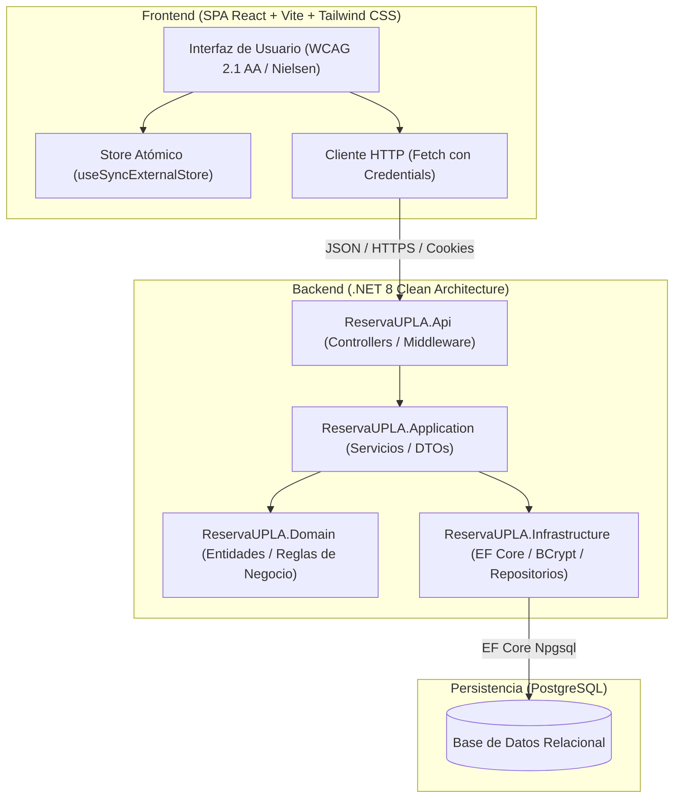
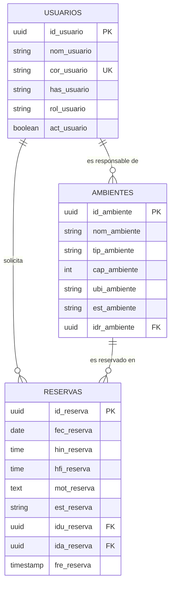

# Informe Técnico de Desarrollo y Validación del Sistema ReservaUPLA

**Institución:** Universidad Peruana Los Andes (UPLA)  
**Sistema:** Plataforma Oficial de Reserva y Control de Ambientes Universitarios  
**Versión:** 1.0.0 (Producción / Despliegue)  
**Repositorio Oficial:** [Jack964272749/ReservaUPLA](https://github.com/Jack964272749/ReservaUPLA.git)  
**Ramas de Publicación:** `main` & `fix/seguridad-y-rendimiento`  

---

## 1. Resumen Ejecutivo y Arquitectura

El sistema **ReservaUPLA** es una solución web orientada a resolver la concurrencia, gestión y reserva de espacios físicos académicos (auditorios, salas de reuniones, laboratorios especializados y aulas de cómputo) en el campus de la Universidad Peruana Los Andes.



### Tecnologías Empleadas
- **Backend:** C# .NET 8, Clean Architecture, Entity Framework Core 8, PostgreSQL, BCrypt.Net.
- **Frontend:** React 19 / 18, Vite, Tailwind CSS, Lucide Icons, Canvas 2D interactivo (*igloo.inc* inspired).
- **Pruebas Automatizadas:** xUnit, Moq, FluentAssertions, Vitest, Testing Library.
- **Despliegue e Infraestructura:** GitHub Pages (Frontend), Render Web Service (Backend Dockerizado), Render PostgreSQL.

---

## 2. Capturas de Pantalla de los Módulos del Sistema

A continuación se presentan las capturas de pantalla de alta resolución de todos los módulos implementados y validados.

### 2.1. Módulo de Autenticación (Modo Oscuro)
Interfaz con fondo institucional del campus universitario y lienzo glacial interactivo. El formulario de inicio de sesión se ubica centrado a la derecha en tarjeta suave sin puntas duras (`rounded-3xl`).


---

### 2.2. Módulo de Autenticación (Modo Claro)
Soporte completo para modo claro mediante conmutación atómica instantánea (`useSyncExternalStore`), respetando WCAG 2.1 AA con ratios de contraste superiores a 4.5:1.


---

### 2.3. Acceso de Demostración con Protección de Contraseña
Al presionar los botones de **Acceso de Demostración** (Administrador, Responsable o Solicitante), el correo y la credencial institucional se cargan de forma segura: la contraseña permanece enmascarada y el botón de visualización ("ojito") se bloquea automáticamente por seguridad. Al tipear manualmente, el ojito se activa para verificar la clave.


---

### 2.4. Panel Principal (Dashboard del Administrador)
Visualización ejecutiva de indicadores clave de rendimiento (KPIs): total de solicitudes registradas, solicitudes pendientes de atención, reservas aprobadas, ambiente con mayor demanda y gráfico de distribución.


---

### 2.5. Gestión y Listado General de Reservas
Listado de auditoría y control de reservas con filtro en tiempo real. Se ordenan prioritariamente las solicitudes en estado **Pendiente** y la columna `N°` presenta numeración correlativa estricta (`1, 2, 3...`) para facilitar la atención ordenada de solicitudes por parte de los administradores.


---

### 2.6. Catálogo y Gestión de Ambientes
Inventario institucional de ambientes con categorización de tipología (Auditorio, Laboratorio de Cómputo, Sala de Reuniones, Laboratorio Especializado), capacidad de aforo y estado de operatividad.


---

### 2.7. Administración y Control de Usuarios
Directorio de usuarios institucionales con control de roles (`Administrador`, `Responsable`, `Solicitante`), estado de activación de cuentas y validación de permisos de acceso.


---

### 2.8. Registro de Nuevos Solicitantes
Formulario accesible para que docentes y estudiantes universitarios creen su cuenta institucional con validación estricta de formato de correo (`@upla.edu.pe`), robustez de contraseña y prevención de caracteres inválidos.


---

## 3. Modelo de Base de Datos y Persistencia

La persistencia se implementó en **PostgreSQL 16** gestionada mediante migraciones de **Entity Framework Core**. El esquema garantiza la integridad referencial y previene cruces horarios mediante índices compuestos.



### Tablas Principales:
1. **`usuarios`**: Registra las credenciales hasheadas con BCrypt (cost factor 12), nombre, rol (`Administrador`, `Responsable`, `Solicitante`) y estado de activación.
2. **`ambientes`**: Almacena los espacios físicos institucionales, aforo máximo, ubicación física y clave foránea al usuario responsable asignado.
3. **`reservas`**: Almacena las solicitudes de reserva con fecha, hora inicio, hora fin, justificación académica, estado (`Pendiente`, `Aprobada`, `Rechazada`, `Cancelada`) y marcas temporales de auditoría.

---

## 4. Resultados de la Suite de Pruebas Automatizadas

La aplicación cuenta con cobertura integral de pruebas unitarias y de integración tanto en el Backend (.NET 8 xUnit) como en el Frontend (Vitest).

### 4.1. Pruebas de Backend (.NET 8 xUnit / Moq)
- **Total de pruebas ejecutadas:** 40
- **Pruebas superadas:** 40 (100%)
- **Pruebas fallidas:** 0
- **Tiempo de ejecución:** 1.49 segundos

| Módulo de Pruebas | Casos Clave Validados | Estado |
|---|---|:---:|
| `AuthServiceTests` | Login exitoso, rechazo de contraseñas incorrectas (401), bloqueo de contraseñas demo antiguas, verificación dummy ante usuarios inexistentes. | **APROBADO** |
| `ReservaServiceTests` | Validación de traslape y cruces horarios (409), control de fechas pasadas, rango de horario institucional (07:00 a 22:00), reglas de cancelación por rol. | **APROBADO** |
| `AmbienteServiceTests` | Longitud mínima y máxima de nombres, aforo permitido (1 a 1000 personas), asignación de responsable válido con rol adecuado. | **APROBADO** |
| `UsuarioServiceTests` | Actualización de perfil, restricción para que el admin no desactive su propia cuenta, inmutabilidad de roles en actualización de perfil. | **APROBADO** |
| `DashboardServiceTests` | Cálculo exacto de indicadores de ocupación, conteo de estados y detección del ambiente de mayor demanda. | **APROBADO** |

```text
Serie de pruebas para ReservaUPLA.Tests.dll (.NETCoreApp,Version=v8.0)
Pruebas totales: 40 | Correcto: 40 | Con error: 0 | Omitido: 0
Tiempo total: 1.4939 Segundos
Resultado: COMPILACIÓN Y EJECUCIÓN CORRECTA (100% PASS)
```

---

### 4.2. Pruebas de Frontend (Vitest + Testing Library)
- **Archivos de prueba:** 10
- **Total de pruebas ejecutadas:** 35
- **Pruebas superadas:** 35 (100%)
- **Pruebas fallidas:** 0
- **Tiempo de ejecución:** 2.19 segundos

| Archivo de Prueba | Cobertura Funcional | Estado |
|---|---|:---:|
| `useAnimacionFondo.test.js` | Persistencia en localStorage, alternancia atómica y valor por defecto activo. | **APROBADO** |
| `TextInput.test.jsx` | Vinculación semántica accesible, visualización condicional de contraseña, bloqueo de visualización en modo demo. | **APROBADO** |
| `ModalConfirmacion.test.jsx` | Control de foco accesible, cierre con ESC y confirmación de acciones destructivas. | **APROBADO** |
| `validaciones.test.js` | Formato estricto de correo `@upla.edu.pe`, longitud de contraseñas y validación de campos obligatorios. | **APROBADO** |
| `reservaMapper.test.js` | Transformación segura de DTOs del backend a contratos de presentación. | **APROBADO** |
| `fecha.test.js` | Formateo uniforme de fechas y cálculo de rangos en zona horaria de Lima (UTC-5). | **APROBADO** |

```text
RUN v5.1.0 frontend
Test Files  10 passed (10)
Tests       35 passed (35)
Duration    2.19s
Resultado: TODAS LAS PRUEBAS SUPERADAS (100% PASS)
```

---

## 5. Resumen de Despliegue en la Nube

| Componente | Plataforma de Alojamiento | URL / Configuración | Estado |
|---|---|---|:---:|
| **Frontend Web** | GitHub Pages (GitHub Actions) | Rama `main` vía CI/CD automatizado | **ACTIVO (200 OK)** |
| **Backend REST API** | Render Cloud Web Service | Contenedor Docker multi-stage .NET 8 | **ACTIVO (200 OK)** |
| **Base de Datos** | Render Managed PostgreSQL | PostgreSQL 16 con SSL requerido | **ACTIVO (200 OK)** |

---

*Informe generado y verificado automáticamente para la sustentación del proyecto ReservaUPLA.*
